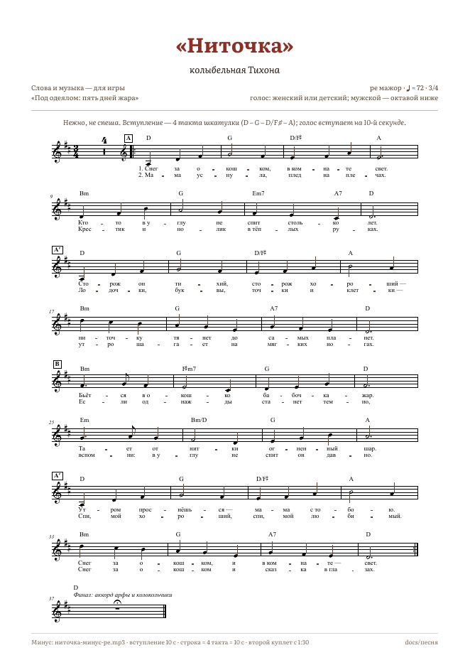

# «Ниточка» — колыбельная Тихона (песня для титров)

В игре песня звучит в титрах: книжка листается под неё сама, а строки куплета «прошиваются» —
паучок тянет под строкой нитку, и строка проступает чернилами ровно тогда, когда её поют.
Сейчас в игре инструментальная версия, голос ведёт паутинная арфа. В этой папке всё, чтобы записать живой голос.
Когда вокал готов, нужно положить один файл, и титры сами заиграют версию с голосом.



## Что в папке

| Файл | Что это |
|---|---|
| `ниточка-ноты.pdf` | 5 страниц: ноты с текстом и аккордами. Ре мажор, фа мажор для Тихона (баритон), то же по-английски, отдельно текст с аккордами |
| `ниточка-минус-ре.mp3` | минус (всё, кроме мелодии), ре мажор: под него пишется голос |
| `ниточка-минус-фа.mp3` | тот же минус в фа мажоре, на малую терцию выше: удобнее баритону |
| `ниточка-мелодия-ре.mp3` | только мелодия (паутинная арфа в 1-м куплете, струнные во 2-м). Минус и мелодия вместе дают трек из игры |
| `ниточка.mid`, `little-thread.mid` | вся аранжировка по дорожкам и партия голоса с текстом (RU / EN). Темп, размер, тональность и аккорды в файле есть |
| `ноты/*.musicxml` | те же ноты для MuseScore, Sibelius, Finale или Dorico: можно транспонировать и печатать |

Всё собирается одним скриптом из того же источника, что и музыка игры: `_исходники/звук/song.py` (см. внизу).

## Песня в двух словах

- **Ре мажор, 3/4, ♩ = 72.** Один такт длится 2,5 с, строка текста занимает 4 такта, это 10 с.
- **Форма:** вступление (4 такта шкатулки) → куплет 1 (32 такта: A A′ B A′) → куплет 2 (те же 32 такта) → финальный аккорд.
  Песня идёт 2:55, вместе с хвостом реверберации 3:01.
- **Мелодия:** диапазон ля малой – ре второй октавы (A3–D5) для женского или детского голоса. Мужской голос поёт её октавой ниже.
  Самое высокое место — начало 4-й строки, «*ни*-точ-ку» / «*спин*-ning» (D5).
- **Аккорды:**
  A — `D | G | D/F♯ | A | Bm | G | Em7 A7 | D`;
  A′ — `D | G | D/F♯ | A | Bm | G | A7 | D`;
  B — `Bm | F♯m7 | G | D | Em | Bm/D | G | A`.
- **Текст:** одна нота — один слог. Русский и английский тексты ложатся на одни и те же ноты без изменений:
  английский перевод подогнан так, чтобы совпало число слогов и ударения. Это проверяет `song.py check`.

## Таймкоды строк

Отсчёт идёт от начала минуса. По этим же числам листаются титры и «прошиваются» строки (`SONG` в `src/config/credits.js`).

| Строка | Куплет 1 | Куплет 2 | Часть |
|---|---|---|---|
| 1 | 0:10 «Снег за окошком, в комнате свет.» | 1:30 «Мама уснула, плед на плечах.» | A |
| 2 | 0:20 «Кто-то в углу не спит столько лет.» | 1:40 «Крестик и нолик в тёплых руках.» | A |
| 3 | 0:30 «Сторож он тихий, сторож хороший —» | 1:50 «Лодочки, буквы, точки и клетки —» | A′ |
| 4 | 0:40 «ниточку тянет до самых планет.» | 2:00 «утро шагает на мягких ногах.» | A′ |
| 5 | 0:50 «Бьётся в окошко бабочка-жар.» | 2:10 «Если однажды станет темно,» | B |
| 6 | 1:00 «Тает от нитки огненный шар.» | 2:20 «вспомни: в углу не спит он давно.» | B |
| 7 | 1:10 «Утром проснёшься — мама с тобою.» | 2:30 «Спи, мой хороший, спи, мой любимый.» | A′ |
| 8 | 1:20 «Снег за окошком, и в комнате — свет.» | 2:40 «Снег за окошком и сказка в глазах.» | A′ |
| — | | 2:50 финальный аккорд (арфа, колокольчики) | |

## Текст

| «Ниточка» | “Little Thread” |
|---|---|
| Снег за окошком, в комнате свет.<br>Кто-то в углу не спит столько лет.<br>Сторож он тихий, сторож хороший —<br>ниточку тянет до самых планет.<br><br>Бьётся в окошко бабочка-жар.<br>Тает от нитки огненный шар.<br><br>Утром проснёшься — мама с тобою.<br>Снег за окошком, и в комнате — свет. | Snow at the window, light in the room.<br>Someone’s kept watch for years in the gloom.<br>Quiet old watchman, kind little keeper —<br>spinning a thread all the way to the moon.<br><br>Ember, the moth, is beating the pane.<br>Thread after thread, the fire will wane.<br><br>Morning will come, and Mama is near you.<br>Snow at the window, and light in the room. |
| Мама уснула, плед на плечах.<br>Крестик и нолик в тёплых руках.<br>Лодочки, буквы, точки и клетки —<br>утро шагает на мягких ногах.<br><br>Если однажды станет темно,<br>вспомни: в углу не спит он давно.<br><br>Спи, мой хороший, спи, мой любимый.<br>Снег за окошком и сказка в глазах. | Mama’s asleep, her blanket pulled tight.<br>Crosses and noughts in warm hands tonight.<br>Little boats, letters, dots and the boxes —<br>morning comes softly on paws made of light.<br><br>If it gets dark, and shadows grow deep,<br>think of the corner, never asleep.<br><br>Sleep now, my darling, sleep now, my dearest.<br>Snow at the window, and dreams in your sight. |

Во втором куплете перечислены игры пяти дней: крестики-нолики, «лодочки» (морской бой), буквы (виселица),
точки и клетки. Последняя строка повторяет первую, только «свет» сменяется «сказкой в глазах»: мальчик засыпает.

## Аранжировка (как в игре)

| Такты | Время | Что звучит |
|---|---|---|
| 1–4 | 0:00 | музыкальная шкатулка одна напевает начало темы |
| 5–36 | 0:10 | **куплет 1**: мелодию ведёт паутинная арфа (октавой выше голоса), под ней вальс фортепиано (бас на «раз», аккорд на «два-три»). С 13-го такта вступают арпеджио арфы, всё время тянется мягкий пэд |
| 37–68 | 1:30 | **куплет 2**: мелодию ведут струнные, переливы даёт челеста, вальс фортепиано продолжается, арфа тоже |
| 69 | 2:50 | финальный аккорд ре мажор: арфа (D3–A4) и три колокольчика (D6, F♯6, A6) с треугольником |

Инструменты — сэмплы VCSL (CC0: фортепиано Knight, арфа, глокеншпиль, треугольник) и синтез
(шкатулка, челеста, струнные, пэд, «паутинная арфа» — щипок по шёлковой нитке).
Если голос записан, мелодию инструментов можно убрать совсем или оставить тихим дублем в первом куплете.
Для этого есть отдельный файл `ниточка-мелодия-ре.mp3`.

## Кому петь

- **Тихон**, голос старого паука, баритон (бриф актёра — в `docs/озвучка/СЦЕНАРИЙ ЗАПИСИ.md`). Для него сделан
  **фа мажор**: минус `ниточка-минус-фа.mp3`, вторая страница нот. Диапазон до малой – фа первой октавы (C3–F4).
  Низкому басу подойдёт ре мажор октавой ниже (A2–D4).
- Женский или детский голос поёт в **ре мажоре** (A3–D5), на первой странице нот.
- По сюжету это колыбельная, которую Тихон пел маме, когда она была маленькой Аней. В финале «Тихон» мама её узнаёт.
  Можно дать маме тихо подпеть последнюю строку второго куплета (без слов, «м-м-м») — для тех, кто прошёл игру,
  это будет узнавание. Это по желанию.

## Как петь

- Это колыбельная у кровати, а не номер на сцене. Петь тихо, близко к микрофону, ровным звуком, без эстрадного вибрато
  и без «злодейских» красок. Тихон страшный только с виду.
- Сильные доли — «*Снег* за о-*кош*-ком, в *ком*-на-те *свет*». Последний слог строки тянуть весь такт и мягко отпускать.
- Вдох — между строками, раз в 10 секунд. В части B можно петь чуть теплее и светлее: это надежда («тает огненный шар»).
- Второй куплет чуть тише первого. Последнюю строку почти прошептать-пропеть: мальчик уже спит.
- Темп не тянуть: под песню листается книжка титров, и строки «прошиваются» по таймкодам из таблицы выше.

## Запись

- WAV 48 кГц / 24 бит, моно, сухо: без реверберации, компрессии и тюна. Пики не выше −6 dBFS.
- В наушниках — минус нужной тональности. Счёт не нужен: 4 такта шкатулки (10 с) задают темп.
  Если нужен клик, его можно взять из MIDI (темп 72, 3/4).
- Каждый дубль писать от начала минуса (0:00), чтобы дубли не пришлось сдвигать.
- 3–4 полных дубля плюс отдельные дубли трудных строк (4-я: верхнее ре; 7-я: «*Ут*-ром прос-*нёшь*-ся»).
- Имена файлов: `ниточка-вокал-<тональность>-дубль<N>.wav`.

## Как вставить в игру

1. Свести минус той же тональности с вокалом. Итог: стерео 48 кГц, громкость около −21 LUFS, пик не выше −1,5 dBFS.
   Старт и длина должны совпадать с минусом: от вступления (10 с) зависят книжка титров и «прошивка» строк.
2. Сохранить как `assets/audio/music/mus_credits_vocal.ogg` и `assets/audio/music/mus_credits_vocal.mp3`
   (Vorbis, q≈4; MP3 128–192 кбит/с; `.mp3` нужен для Safari).
3. Пересобрать игру: `npm run build`. Титры сами найдут файл и сыграют версию с голосом, а без файла — инструментальную.
   Если пересобрать нельзя, можно положить оба файла в `dist/audio/music/` и дописать их пути
   (`audio/music/mus_credits_vocal.ogg`, `…mp3`) в список `files` файла `dist/asset-list.json`.
4. Если поменялись темп или форма, поправить `SONG` в `src/config/credits.js`.

## Пересборка

```bash
cd _исходники/звук
python3 song.py check        # текст ложится на мелодию и совпадает с текстом в игре
python3 song.py midi         # ниточка.mid, little-thread.mid
python3 song.py pdf          # ноты/*.musicxml и ниточка-ноты.pdf (нужны pip-пакет verovio и chromium)
SFX_SRC=<папка с сырьём> python3 song.py audio      # минус, мелодия и трек игры mus_credits, ре мажор
SFX_SRC=<папка с сырьём> python3 song.py audio 3    # минус в фа мажоре (сдвиг в полутонах: 2 — ми, 5 — соль, −2 — до)
```

Мелодия и аккорды — `MEL_A`, `MEL_A2`, `MEL_B`, `CH_*` в `build_music.py`, аранжировка — `credits()` в `build_music2.py`,
текст по слогам — `LYRICS` в `song.py`. Сэмплы скачиваются один раз: `fetch_sources.py`.

### Дорожки MIDI

Голос (с текстом), шкатулка (вступление), паутинная арфа (мелодия, 1-й куплет), вальс фортепиано (1-й куплет),
струнные (мелодия, 2-й куплет), челеста, вальс фортепиано (2-й куплет), арпеджио арфы, бас, пэд, финальный аккорд
(арфа и колокольчики), треугольник. Голос записан там же, где поётся (A3–D5), инструменты — на своих высотах.
Символы аккордов и метки частей (Intro, Verse 1, Verse 2, Final chord) лежат на первой дорожке.
